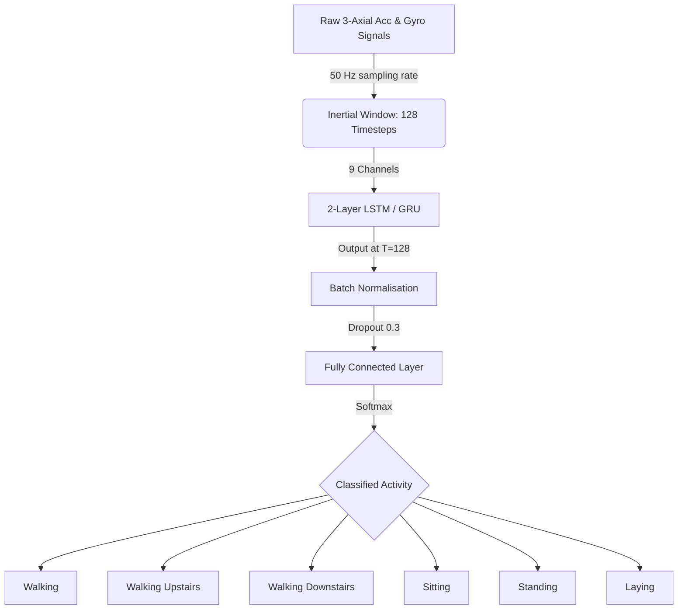

# 🏃 Human Activity Recognition using Smartphone Sensors (LSTM & GRU)

[](https://www.python.org/)
[](https://pytorch.org/)
[](https://opensource.org/licenses/MIT)

An ultra-premium, interactive deep learning analytics dashboard that classifies physical activities (walking, sitting, laying, etc.) using raw smartphone accelerometer and gyroscope time-series signals. Built using **PyTorch** for model training and **Streamlit** for the frontend dashboard.

---

## 🚀 Live Demo
🔗 **Deploy Link:** **[View Live Dashboard](https://humanactivityrecognition-abx5swcqueciwd6zscz2xl.streamlit.app/)**

---

## 📊 Model Performance & Comparison
We trained a 2-layer **LSTM** and a 2-layer **GRU** on **9 channels of raw inertial signals** (128 time-steps per sample, 50Hz sampling rate).

| Model | Architecture | Test Accuracy | Weighted F1 | Params | Speed / Epoch |
| :--- | :---: | :---: | :---: | :---: | :---: |
| **LSTM** | 2 Layers, Hidden=128 | **92.03%** | **91.91%** | ~203K | ~13.5s (CPU) |
| **GRU** | 2 Layers, Hidden=128 | **92.20%** | **92.13%** | ~154K | ~26.0s (CPU) |

### 🏆 Key Insights:
* **The Winner:** **GRU** slightly outperforms LSTM by **+0.17%** accuracy.
* **Efficiency:** GRU achieves this performance with **24% fewer parameters**, making it more lightweight and suitable for edge-device deployment.
* **Classification Ease:** Sitting, Standing, and Laying are classified with near **100% precision**. Dynamic activities like Walking Upstairs/Downstairs exhibit minor mutual misclassifications.

---

## 🎨 Dashboard Features
The Streamlit application features a premium dark glassmorphism design with floating background particles and 7 immersive tabs:

1. 🏠 **Overview**: Interactive system architecture flowchart, key performance cards, and high-level summaries.
2. 📊 **Model Comparison**: Rotating ring visualizations displaying test accuracy metrics and comprehensive performance radar charts.
3. 📈 **Training Analytics**: Training/validation curves for loss, accuracy, epoch-time tracking, and learning rate decay.
4. 🔬 **Confusion Matrices**: Normalised classification heatmaps and a custom **GRU vs. LSTM error delta** heatmap.
5. 🌊 **Sensor Signals**: Raw signal visualizer. Allows you to view and compare time-series signals for accelerometer and gyroscope across all 3 axes (X, Y, Z).
6. 🎯 **Per-Class Analysis**: Categorical distribution donuts and prediction confidence distribution charts.
7. ⚙️ **Architecture**: Internal model structural flow diagrams and hyperparameter configuration tables.

---

## 📁 Repository Structure
```directory
├── model_outputs/
│   ├── data_stats.json          # Pre-computed statistics and signal samples
│   ├── LSTM_results.json        # LSTM metrics, training history, and probabilities
│   ├── GRU_results.json         # GRU metrics, training history, and probabilities
│   └── comparison.json          # High-level comparison summary
├── dashboard.py                 # Streamlit application entry point
├── train_models.py              # PyTorch model training pipeline script
├── requirements.txt             # Lightweight deployment requirements
└── README.md                    # Project documentation
```

---

## 💻 Local Setup & Execution

### 1. Clone the repository:
```bash
git clone https://github.com/bhartenduji/Human_Activity_Recognition.git
cd Human_Activity_Recognition
```

### 2. Install dependencies:
```bash
pip install -r requirements.txt
```

### 3. Run the Dashboard:
```bash
streamlit run dashboard.py
```

---

## ⚙️ How it Works & Neural Network Architecture



* **Dataset:** UCI Human Activity Recognition (HAR) Dataset.
* **Input Window:** $128 \times 9$ matrix (128 time steps, 3 body acceleration axes, 3 gravity acceleration axes, and 3 angular velocity axes).
* **Batch Normalization & Dropout:** Used to stabilize gradients and prevent overfitting.

---

## 🤝 Contributing & License
Contributions, issues, and feature requests are welcome! Feel free to check the [issues page](https://github.com/bhartenduji/Human_Activity_Recognition/issues).

Distributed under the MIT License. See `LICENSE` for more details.
